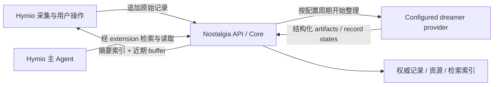

# Nostalgia MVP 设计

状态：Implemented（MVP）。本文固定职责、数据语义和处理流程；[API](api.md) 固定交互契约；[场景](scenarios.md) 用于检查实现。当前适配器使用 SQLite，逻辑模型不绑定其物理字段。

## 目标与边界

Nostalgia 保存个人 Context 的原文与制品，提供一套 API。增删改查中的内容变更先追加到原始记录，dreaming Agent 阅读内容和操作意图，自行决定怎样维护制品；提交完成后才改变生效结果。

接收成功只表示可靠保存。新的原始内容立即可读、可检索、可进入 buffer，但不表示相应制品已更新。修改、删除意图也遵守这个规则，接收时不自动使旧制品失效。

Hymio 负责来源授权、连接器、媒体解析、API 包装、tool/skill 和模型上下文注入。Nostalgia
负责 dreaming 的调度、草稿生命周期、校验与提交，并通过配置的 proposal provider 获取结构化
提炼结果。Provider 不直接写存储；Hymio 只配置 extension 并代理自己的用户请求。

## 三层结构

- API：认证、参数校验、幂等、错误与分页，接收和返回公开协议对象。
- Core：原始记录、制品与溯源、整理草稿与发布、摘要与 buffer、查询。
- Storage：记录事务、原始资源读写、全文与可选语义索引。Core 使用接口，不依赖某个数据库的字段布局。

原始记录和制品的权威状态保存在关系型存储。来源引用的正反向查询也必须能够在权威存储完成；索引只负责加速，允许延迟或重建。

## 三张核心逻辑表

下面描述需要表达的信息，不要求实现采用固定列名。幂等、资源或索引可有辅助存储，不要求全部挤进三张表。

### 原始记录

至少保存自增 ID、用户、item 类型（context / command）、context 类型和 JSON 内容、command 类型和 JSON 内容、来源生产时间、服务写入时间、根 ID、状态。来源未提供生产时间时保留未知，不以写入时间冒充。来源身份还包含 namespace、external_id 和可选来源版本；namespace 应区分同渠道不同账号。

context 保存内容或持久资源引用，command 保存类型、自然语言意图及可选目标引用。两种 payload 互斥。原始正文、来源和生产时间在接收后不覆盖；后续变更追加新行。

根 ID 是这份 context 最早的原始行 ID，新 context 的根 ID 指向自己。同一份内容的多次变更共享根 ID；独立 command 可以拥有自己的根 ID，在 command 内容中指定一个或多个目标根 ID。跨来源的相似内容不自动共用根 ID。

区分两个状态含义：记录是否已经被审阅，以及内容当前是否生效。新记录待整理；command 可以已执行、无需操作或待澄清；context 可以生效、过时或删除。状态可用字段或处理元数据表达，不把所有组合塞进一个枚举。

Agent 对记录状态的调整先保存在整理草稿中，提交时才应用。语义删除标记内容不再参与默认检索，原始正文仍保留用于追溯；彻底物理清除不包含在 MVP。已发布删除不因后续同步自动复活，恢复需要明确的 restore 意图。

### 版本记录

至少保存用户、内部版本 ID、状态、已处理游标和时间。整理草稿还记录基于哪个生效结果、固定输入截止 ID，以及恢复所需的处理进度。

每用户至多一个生效版本和一个未结束的草稿。内部版本号不作为普通读取参数；对外只提供一次整理的 `dream_id`。无制品时使用空摘要、空制品和游标 0。

游标表示其之前的记录均已得到处理结论，不表示每个 command 都执行成功。待澄清也要有原因并保持可单独查询，不能被当成执行成功；Hymio 可展示该状态，用户澄清后追加引用原请求的新 command。

### 版本详情

保存该版本的制品正文、稳定制品 ID、可选 topic/类型/结构化内容、来源引用和状态。摘要索引也是特殊制品。草稿中对原始记录状态的待提交调整可以作为详情中的另一类条目保存，同时保留回退所需的前后状态。

MVP 的普通制品采用独立卡片：正文表达一段能独立维护的内容，可带多个 topic；topic 先作为分组，不要求树或自动聚类。`field/value` 可以通过可选结构化内容承载，不限制所有制品必须是键值对。

每份普通制品必须引用原始根 ID，并记录实际依据的原始行 ID，必要时带段落、消息或媒体时间位置。多对多来源引用支持从制品找原文，也支持从根 ID 找全部相关制品。引用表明依据，不自动证明提炼内容正确。

可保留少量制品间关联用于展开。摘要索引列出的制品 ID 必须在同一发布结果中存在；其原始依据通过这些制品追溯。源引用和分组可以保存在详情字段或辅助关系中，API 语义相同。

## Dreaming 与发布

1. Hymio 开始整理。Nostalgia 从当前生效结果创建草稿，记下已处理游标 C 和已可靠写入的截止 ID H。
2. Agent 完整分页读取本用户 `(C, H]` 的记录，检索相关历史原文与制品；历史读取限定在 H 内。近期 buffer 不能代替这份输入列表。
3. Agent 修改草稿制品、来源引用和原始记录的处理状态。每条输入都需有处理结论；无需改变制品也是合法结论。
4. Agent 重新生成有长度上限的摘要索引。没有内容变化时也在本批显式保存已验证的摘要，不能遗漏这一步；随后再改普通制品或原始状态，需要重新确认并保存摘要。
5. Hymio extension 请求提交。Nostalgia 检查输入处理完整、引用属于本用户且可定位、摘要引用和大小合法，以及被删除根 ID 的关联制品已处理。
6. 一个事务发布新制品、摘要、原始记录状态和游标 H。普通读取随后使用新结果，buffer 的未整理范围同步变为 H 之后。

检查能保证引用与状态一致，不能验证每句话的语义。若某根被标记删除，关联制品必须由 Agent 删除或改写并移除该来源；服务报告遗漏，不替 Agent 自动改写内容。

H 之后的新增、修改和删除继续可靠入库，进入 buffer，下次整理再决定如何处理；本次不追赶最新写入。模型执行期间不持有长数据库事务。

自增 ID 用作游标时，必须保证固定边界内不会再出现迟提交的本用户记录。MVP 可以将同用户的 ID 分配、追加事务和边界截取短时串行化；不能直接把无序并发事务的 `MAX(id)` 当完整边界。ID 允许有空洞。

草稿持久保存，重启后可读取并继续；放弃不改变生效结果或游标。提交和放弃均幂等，提交成功但回包丢失时查询整理状态或重试即可。MVP 不自动合并多个草稿。

## 摘要索引与近期 buffer

注入内容由一个读取操作返回：当前生效摘要索引，加上该游标之后的近期原始记录。两者从同一一致视图读取，不暴露半成品摘要，也不能混用旧摘要与已清理的 buffer。

摘要是短导航：有哪些主题、关键状态、继续读取的制品 ID。它由 dreaming 维护，有独立长度上限，不要求包含全部资料或全部制品。

buffer 按写入顺序保留最近记录，展示时按 ID 升序排列；来源生产时间仅作为内容信息，晚到的旧资料仍作为新输入。context 和 command 都可进入，每项包含原始行 ID、类型、生产时间和截断预览，明确标记待整理。

同时限制 buffer 条数、每项预览长度和整个注入响应大小，连同 ID 等元数据计算预算。MVP 以 Unicode 字符数规定硬上限；Hymio 可以另外按实际模型的 token 预算裁剪。正文截断不破坏字符，单条超大 JSON 不会撑破注入预算。

容量不足时淘汰最早预览，不删除原始记录、不推进整理游标。返回未展示记录数与截断标记，Agent 可用原始 ID 或查询接口读取完整内容。

提交只移除本批截止 H 以内的 buffer 项，保留 H 之后的项；失败保持原游标，buffer 仍按容量自然淘汰。buffer 可以通过游标和原始表直接计算，也可以缓存，必须可重建。

## 保留、回滚与检索

原始数据默认保留。制品保留当前及最近 N-1 个可回退的完整发布结果，N 可配置；未变化的内容允许复用。清理历史制品不能清掉当前或保留版本仍引用的内容和依据。任务终态和幂等回执继续保留，不要求历史制品详情永久存在。

MVP 提供最近一次发布的回退，不提供任意版本编辑。回退恢复前一套制品、摘要、游标及原始记录的处理/生效状态，包括 command 审阅结论；保留全部原始日志，恢复游标之后的记录重新标记待整理。授权状态独立验证，不随回退恢复。存在草稿时先结束草稿，避免基于过期状态继续提交。

基础检索支持按 ID 读取，按根 ID 读取历史，按来源、context 类型、topic、状态、生产时间或写入时间过滤，以及文本搜索。语义检索是可选能力。制品支持按来源根 ID 完整分页查询，便于删除和修正；不能用 top-k 相似搜索代替。

普通读取使用当前生效制品；原始搜索可包含待整理内容并明确其状态，默认排除已发布删除的内容。dreaming 和溯源可显式查询保留历史及删除标记。命中要带身份、来源和状态，不把近期预览或旧制品当已确认的新结论。

索引结果需回到权威状态校验，不得返回已删除制品。索引落后时通过权威读取补齐精确查询，文本/语义搜索报告实际索引范围，不能把暂未索引说成没有数据。

## 部署和接入

一个 Docker 服务监听配置端口；连接凭据和资源目录通过部署配置注入，持久数据放持久卷或外部存储。公开健康检查及协议能力信息，内部数据库、索引和文件路径不进入业务协议。

Nostalgia 维护 HTTP 协议；Hymio extension 封装查询和整理工具，自动携带用户授权与 `dream_id`。Hymio 读取注入内容后负责真正放入模型输入；不能仅把它放进 Oath 透传的 `user_context` 就假定模型已看到。

与 Hymio 导入同步草案对接时，持久回执只推进来源采集进度，dreaming 游标独立推进。来源删除先记录 command，生效时间以本设计的发布规则为准；来源版本冲突仍返回冲突，不通过重读后盲目覆盖解决。外部凭据不进入原始内容或模型上下文。

MVP 包含内部整理调度器和单次 provider 提案闭环，不包含复杂知识图谱、自动 topic 重组、
时间衰减、专用召回编排或数据库多实现。保留 JSON 内容、可选能力与存储接口。
